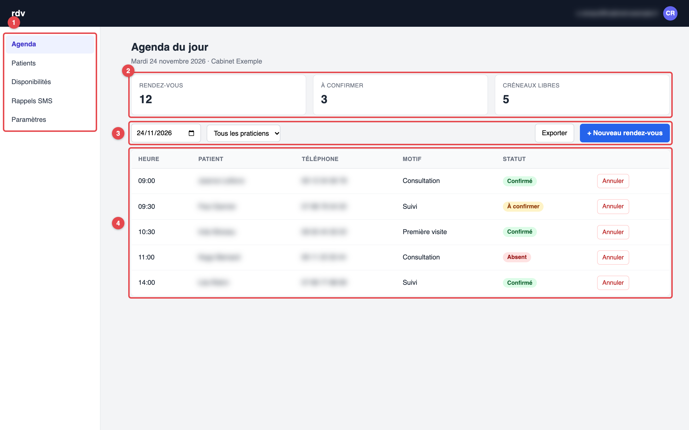
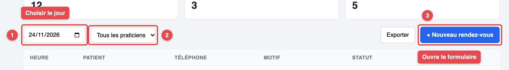
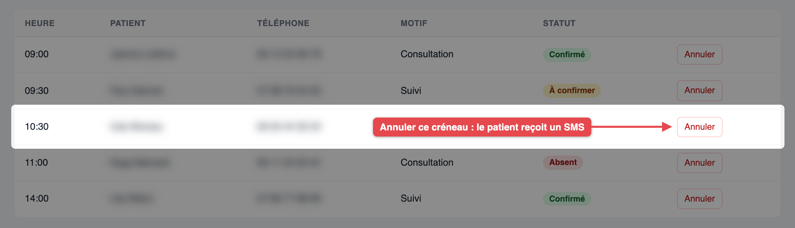

# doc-screenshots

> **Ne jamais « dessiner » sur une image.** Les annotations sont injectées dans la page, ancrées sur de vrais éléments, avant la capture. Elles tombent au pixel près, et une recette versionnée régénère toutes les images quand l'interface change.

Demander à une IA de placer une flèche sur un PNG, c'est lui demander de deviner des coordonnées à l'œil : ça tombe à côté. Ce plugin pilote [agent-browser](https://github.com/vercel-labs/agent-browser) pour dessiner **dans** la page :
- **des cadres numérotés** qui renvoient aux étapes du texte ;
- **des notes courtes**, et **des flèches** vers les petites cibles ;
- **une mise en lumière** qui assombrit le reste de l'écran ;
- **le floutage des données personnelles**, fait dans la page, donc la donnée n'est jamais en clair dans le PNG ;
- **un recadrage** sur la zone utile, en retina.

Pastilles et notes se placent **automatiquement** : le script évite le contenu de la page, les autres cadres et les bords, et refuse les positions ambiguës.

## Exemples

Générés par `capture.py` à partir de [`assets/demo/captures.json`](skills/doc-screenshots/assets/demo/captures.json), sur une page de démo (données fictives).

**Vue d'ensemble d'un écran** : des numéros, et la légende dans le texte de la doc.


**Une procédure** : les étapes numérotées et une note, recadrées sur la barre d'outils.


**Une action précise** : mise en lumière de la ligne, flèche vers le bouton, noms et téléphones floutés.


## Une recette de capture

```json
{
  "defaults": { "viewport": [1440, 900, 2], "session": "doc", "state": "auth.json" },
  "captures": [{
    "name": "annuler-un-rendez-vous",
    "url": "http://localhost:3000/agenda",
    "wait": { "selector": "#agenda" },
    "annotations": [
      { "selector": "#rdv-1030", "type": "spotlight" },
      { "selector": "#annuler-1030", "type": "arrow", "note": "Annuler ce créneau", "side": "left", "frame": false },
      { "selector": "#agenda td.pii", "type": "blur" }
    ],
    "crop": "#agenda",
    "output": "../img/agenda-annuler.png"
  }]
}
```
```bash
python3 plugins/doc-screenshots/skills/doc-screenshots/scripts/capture.py docs/captures/agenda.json
```

## Installation

```
/plugin marketplace add BEIRDINH0S/senior-claude
/plugin install doc-screenshots@senior-claude
```
Il faut aussi agent-browser (testé avec la 0.43) :
```bash
brew install agent-browser     # ou : npm install -g agent-browser
agent-browser install          # télécharge Chrome for Testing
```

## Licence

[MIT](../../LICENSE)
