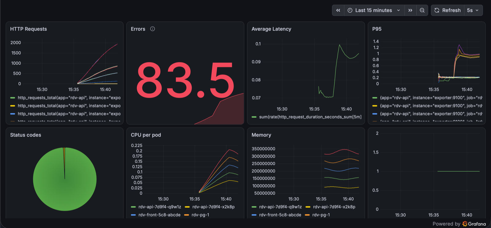
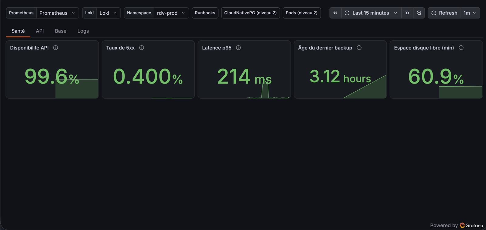
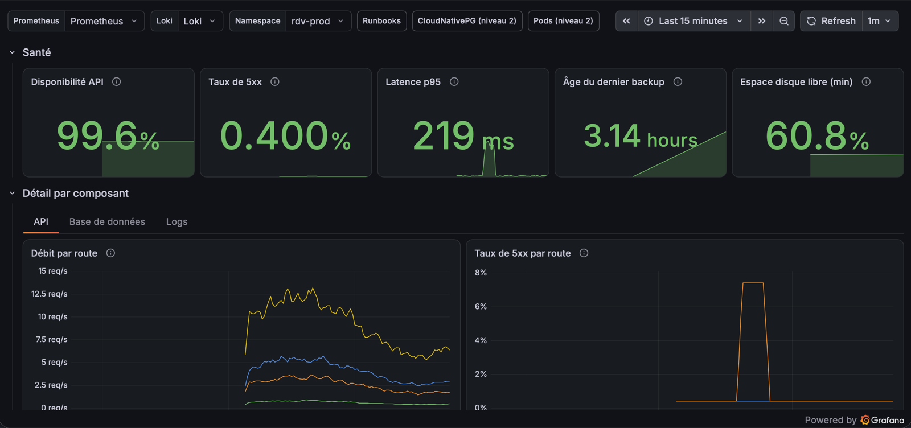

# grafana-dashboards

> **Un dashboard sert à diagnostiquer, pas à surveiller.** Ce sont les alertes qui préviennent. Quand une alerte sonne, le runbook dit quoi regarder, et le dashboard montre en 5 secondes où est le problème, puis mène jusqu'aux logs.

Laissée à elle-même, une IA produit un « mur de métriques » : toutes les métriques disponibles, sans hiérarchie, sans unités, avec des compteurs bruts, des moyennes de latence, une courbe par pod et un camembert. Ce plugin encode une autre méthode, recoupée avec la documentation Grafana, la méthode RED, la méthode USE et le livre SRE de Google (sources en fin de [`standard.md`](skills/grafana-dashboards/references/standard.md)).

## Trois dashboards, mêmes données

Captures prises sur Grafana 13.3 avec les mêmes métriques (une app de prise de rendez-vous fictive, avec un incident simulé sur `POST /api/rdv`).

### 1. Le dashboard qu'une IA génère par défaut


Le linter remonte 5 erreurs et 38 avertissements :
- **compteurs tracés sans `rate()`** : des courbes qui montent à l'infini ;
- **un p95 calculé sans `le`** : la valeur est fausse ;
- **une moyenne de latence** ;
- **une courbe par pod** ;
- **un camembert** ;
- **aucune unité ni description**, **une source de données en dur**, **un rafraîchissement à 5 s**, **15 panneaux à plat**.

Le « 83.5 » en rouge géant est un compteur brut d'erreurs depuis le démarrage : un nombre sans signification, qui ne fait que monter. Le camembert est entièrement vert, alors qu'un incident est en cours sur une route. Pendant l'incident, rien ne dit si ça va ni quoi faire.

### 2. Bien construit, mais le bandeau de santé est caché dans un onglet


Les panneaux sont corrects, mais le bandeau de santé n'est qu'un onglet parmi d'autres. Dès qu'on passe sur l'onglet API pour creuser, il disparaît : si le disque ou les backups virent au rouge pendant ce temps, on ne le voit pas. Le linter remonte `BANDEAU-CACHE`.

### 3. La référence : bandeau toujours visible, détail en onglets


- **Le bandeau de santé** dit en 5 secondes quel composant souffre : disponibilité, 5xx, latence p95, âge du dernier backup, disque.
- **Les onglets** contiennent le RED de chaque composant dans l'ordre du flux. Sur la capture, le taux de 5xx **par route** montre que le pic venait d'une seule route, invisible dans un chiffre global.
- **Chaque panneau** a une unité et une description « Montre / Normal / Si anormal → runbook ».
- **Le panneau des 5xx** ouvre les logs d'erreur de la même période dans Loki.

Le linter ne remonte aucun constat.

## Les skills

| Skill | Pour |
|---|---|
| **grafana-dashboards** | Le standard (hiérarchie, bandeau et onglets, RED/USE, visualisations, requêtes, boucle avec les runbooks, GitOps), l'exemple de référence et le linter |
| **grafana-dashboards-design** | Concevoir à partir des **alertes, des runbooks et des métriques réelles**, valider le plan avec l'utilisateur, écrire le JSON au schéma v2, fermer la boucle (runbook → panneau, alerte → panneau), livrer en GitOps |
| **grafana-dashboards-check** | Linter, puis relecture (test des 5 secondes, seuils alignés sur les alertes, métriques qui existent vraiment), rapport priorisé, job de CI |

## Le linter

```bash
python3 plugins/grafana-dashboards/skills/grafana-dashboards/scripts/lint_dashboard.py dashboards/ --runbooks docs/runbooks
```
- **Schémas** : v1 (`panels[]`, rows comprises) et v2 (`elements` + `layout`, brut ou en ressource Kubernetes).
- **Ce qu'il vérifie** : 20 règles, dont `RATE-MANQUANT`, `QUANTILE-SANS-LE`, `LATENCE-MOYENNE`, `SERIE-PAR-POD`, `DS-EN-DUR`, `BANDEAU-CACHE`, `SEUIL-SANS-RUNBOOK` et `RUNBOOK-INTROUVABLE`.
- **Avec `--runbooks`** (le dossier du plugin ops-doc) : il vérifie les liens vers les runbooks et liste ceux dont le symptôme n'a aucun panneau.
- **Dépendances** : bibliothèque standard Python uniquement. Code de sortie 1 en cas d'erreur.

## Déploiement

Le plus simple : le **sidecar du chart Grafana**, avec une ConfigMap par dashboard générée par Kustomize, et **ArgoCD en `ServerSideApply=true`**. Sans cette option, la limite de 256 Ko de l'annotation `last-applied-configuration` bloque les gros dashboards. Détails dans [`gitops-sidecar.md`](skills/grafana-dashboards/references/gitops-sidecar.md).

## Avec les autres plugins

- **ops-doc** : les runbooks sont la source des panneaux, et les panneaux renvoient aux runbooks.
- **kube-logs** : les logs JSON dans Loki sont la cible des liens de données.

## Installation

```
/plugin marketplace add BEIRDINH0S/senior-claude
/plugin install grafana-dashboards@senior-claude
```

## Licence

[MIT](../../LICENSE)
