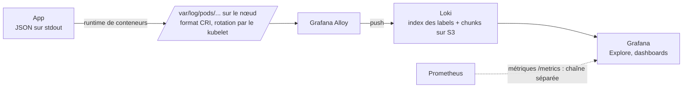

# Le standard kube-logs

> **Le principe.** L'app écrit **une ligne JSON par événement sur stdout**, et c'est tout. La plateforme (le runtime de conteneurs, Alloy, Loki et Grafana) collecte, transporte, stocke, fait tourner les fichiers, applique la rétention et affiche. L'app ne gère ni fichier, ni rotation, ni envoi réseau, ni format d'affichage.

## Sommaire
1. La chaîne des logs sur Kubernetes
2. Pourquoi pas de fichiers de logs (ni sur un PVC)
3. Le format d'une ligne de log
4. Les niveaux
5. Ce qu'on ne logue jamais
6. Labels Loki : peu, statiques, bornés
7. Rétention et stockage
8. Logs ou métriques ?
9. Règles vérifiées par les scripts
10. Sources

---

## 1. La chaîne des logs sur Kubernetes



- **L'app** écrit sur stdout (stderr est accepté, mais tout mettre sur stdout est plus simple).
- **Le runtime de conteneurs** (containerd) écrit le flux dans `/var/log/pods/<namespace>_<pod>_<uid>/<conteneur>/N.log`, en préfixant chaque ligne au format CRI (horodatage, flux, marqueur de ligne partielle).
- **Le kubelet fait la rotation**, avec `containerLogMaxSize` (10 Mi par défaut) et `containerLogMaxFiles` (5 par défaut) dans sa configuration. Sur le nœud, les logs ne vivent donc que peu de temps. De plus, `kubectl logs` ne montre que le fichier le plus récent : au-delà, il faut Loki.
  - Les logs comptent probablement dans l'`ephemeral-storage` du pod. C'est signalé par des utilisateurs, pas documenté officiellement. Une limite d'`ephemeral-storage` plus petite que `containerLogMaxSize × containerLogMaxFiles` exposerait le pod à une éviction causée par ses seuls logs.
- **Alloy** collecte et pousse vers Loki, en ajoutant les labels Kubernetes. Deux façons de faire :
  | Composant | Fonctionnement | Compromis |
  |---|---|---|
  | `loki.source.file` + `discovery.kubernetes` | DaemonSet qui lit `/var/log/pods` sur chaque nœud ; `stage.cri` retire le préfixe CRI | accès au système de fichiers du nœud, mais charge minimale |
  | `loki.source.kubernetes` | passe par l'API Kubernetes, comme `kubectl logs` | ni DaemonSet, ni accès au nœud, ni privilèges, mais plus de trafic réseau et de CPU sur le kubelet |
- **Loki** n'indexe que les **labels**, pas le contenu. Il stocke les lignes compressées par blocs (chunks) sur l'objet storage (S3). Une requête sélectionne d'abord des flux par labels, puis parcourt leur contenu. D'où l'importance des labels (section 6).
- **Grafana** interroge Loki en LogQL.
- **Prometheus ne touche pas aux logs.** Il récupère des métriques sur des endpoints `/metrics`. Les deux chaînes se rejoignent dans Grafana, et par le **ruler de Loki**, qui peut évaluer des requêtes LogQL et envoyer le résultat à Prometheus (remote write) ou à Alertmanager.

## 2. Pourquoi pas de fichiers de logs (ni sur un PVC)

| Problème | Conséquence |
|---|---|
| **Invisible pour la chaîne standard** | `kubectl logs` ne montre rien, Alloy ne collecte rien sans configuration spéciale, et il faut un `exec` dans le pod pour lire |
| **Un PVC `ReadWriteOnce` attache le pod à un nœud** | pas de second réplica sur un autre nœud ; un drain bloque ou casse ; le scaling horizontal devient impossible |
| **Rotation à votre charge** | sans logrotate, le volume se remplit et l'app plante ou se bloque en écriture : une panne causée par les logs eux-mêmes |
| **Pas de vue d'ensemble** | un fichier par pod : pour suivre une requête qui traverse deux réplicas, il faut fouiller deux volumes |
| **Durée de vie liée au volume** | supprimer le PVC efface l'historique ; pas de rétention maîtrisée |
| **Coût** | écritures disque dans le chemin de la requête, stockage bloc plus cher qu'un objet S3 compressé |

Un sidecar `tail -f /logs/app.log` qui recopie un fichier sur stdout est un pansement pour une app qu'on ne peut pas modifier. La documentation Kubernetes décrit ce motif pour ce cas-là. Si on peut modifier l'app, on la fait écrire sur stdout.

## 3. Le format d'une ligne de log

**Une ligne = un objet JSON = un événement.** Aucun saut de ligne à l'intérieur : un message sur plusieurs lignes est découpé en plusieurs entrées, et c'est la première cause de logs illisibles (stack traces, objets affichés sur plusieurs lignes).

Être en JSON ne suffit pas : il faut aussi un **schéma stable**. La documentation OpenTelemetry le rappelle : un log encodé en JSON n'est pas pour autant structuré si ses champs changent d'une ligne à l'autre.

| Champ | Type | Rôle |
|---|---|---|
| `time` | chaîne ISO 8601 | horodatage de l'événement |
| `level` | **chaîne** : `debug`, `info`, `warn`, `error`, `fatal` | filtrer et compter. Pas un nombre : `30` ne se lit pas dans Grafana. Équivalent OpenTelemetry : `SeverityText` |
| `msg` | chaîne courte et **stable** | ce qui s'est passé (« commande créée »). Les valeurs variables vont dans des champs |
| `service` | chaîne | quelle app |
| `req_id` | chaîne | suivre une requête HTTP dans une app ; repris de l'en-tête `x-request-id` s'il existe |
| `trace_id`, `span_id` | chaînes hexadécimales minuscules | si l'app est tracée : noms recommandés par OpenTelemetry pour les logs JSON, à la racine de l'objet |
| `err` | objet `{type, message, stack}` | l'erreur sérialisée, stack comprise, **dans un champ JSON**, donc sur une ligne |
| contexte | champs nommés, sous une clé contrôlée | `order_id`, `route`, `status_code`, `duration_ms`… |

```json
{"time":"2026-11-23T14:02:11.482Z","level":"error","service":"rdv-api","req_id":"8f1c2a","msg":"échec de création du rendez-vous","route":"POST /api/rdv","status_code":500,"err":{"type":"PoolTimeoutError","message":"timeout acquiring connection","stack":"PoolTimeoutError: timeout...\n    at ..."}}
```
Les `\n` de la stack sont échappés dans la chaîne JSON : la ligne reste unique.

**Message stable, contexte en champs** : on écrit `logger.info({ order_id }, "commande créée")`, pas `logger.info("commande " + id + " créée")`. On peut ainsi compter les « commande créée » et filtrer sur `order_id`.

**Une entrée extérieure va sous une clé à soi** : `logger.info({ body: req.body }, ...)` plutôt que `logger.info(req.body, ...)`. Sinon, un champ `level` ou `msg` venu du client écrase les vôtres (c'est une recommandation de la doc pino).

## 4. Les niveaux

| Niveau | Quand | Qui réagit |
|---|---|---|
| `fatal` | l'app va s'arrêter | l'astreinte |
| `error` | une opération a échoué et quelqu'un devrait s'en occuper | l'équipe, rapidement |
| `warn` | anormal mais géré (nouvel essai réussi, valeur par défaut appliquée) | à surveiller en tendance |
| `info` | les événements métier et le cycle de vie (démarrage, arrêt, action importante) | personne |
| `debug` | le détail pour développer | désactivé en prod, activable via la variable d'env `LOG_LEVEL` sans redéployer de code |

Une erreur **attendue** (un 404, une validation refusée) n'est pas un `error`. Sinon, ce niveau ne veut plus rien dire et on cesse de le regarder.

## 5. Ce qu'on ne logue jamais

- **Les secrets** : mots de passe, tokens, en-têtes `Authorization` et `Cookie`, clés d'API, chaînes de connexion.
- **Les données personnelles en clair** (RGPD) : e-mail, téléphone, adresse, contenu saisi. Pour corréler, on logue un identifiant interne.
- **Des corps de requête ou de réponse entiers**, où se cachent les deux catégories précédentes.

Le masquage est **configuré dans le logger** (l'option `redact` de pino, par chemin de champ), pas confié à la vigilance de chacun. Un jour, quelqu'un loguera l'objet `req` en entier.

## 6. Labels Loki : peu, statiques, bornés

Loki crée un **flux** par combinaison unique de labels, avec son propre index et ses propres chunks. Un label à valeurs nombreuses multiplie les flux : l'ingestion ralentit, les petits chunks font exploser le nombre d'objets S3, et on finit par atteindre les limites. La documentation Loki fixe la limite par défaut à 15 labels par flux et recommande **5 à 10 labels statiques au maximum**.

La règle de la documentation Loki : **si on filtre dessus dans presque chaque requête, c'est un label. Si on n'en a besoin qu'occasionnellement, ou s'il a beaucoup de valeurs, on le met en structured metadata ou on le parse au moment de la requête.**

| Champ | Où le mettre |
|---|---|
| `namespace`, `app`/`service_name`, `container`, `cluster`, `env` | **label** : peu de valeurs, stables |
| `level` | label possible : 5 valeurs. Sinon, on le filtre avec `\| json` |
| `pod` | **structured metadata** : change à chaque déploiement. C'est le comportement par défaut récent de Loki pour `k8s.pod.name` |
| `trace_id`, `req_id` | **structured metadata** (filtrage rapide sans créer de flux) ou dans le JSON |
| `user_id`, `order_id`, `ip`, `path`/`url`, `email`, `session` | **dans le JSON**, filtré à la requête (`\| json \| order_id="42"`) ; **jamais en label** |

Les structured metadata (Loki 3+) sont attachées à la ligne sans être indexées comme des labels et sans créer de flux. Dans Alloy : `stage.json` extrait les champs, puis `stage.labels` en promeut quelques-uns en labels et `stage.structured_metadata` attache les autres.

## 7. Rétention et stockage

- **La rétention de Loki est désactivée par défaut : sans configuration, les logs sont gardés pour toujours.** Il faut `retention_enabled: true` dans le bloc `compactor`, un `delete_request_store` (par exemple `s3`) et une `retention_period` dans `limits_config`. Le réglage dans `limits_config` seul ne suffit pas.
- Le compactor tourne en **instance unique**. Ses fichiers de marquage doivent être durables : un volume persistant, ou le préfixe dans l'objet storage.
- Un changement de rétention **n'est pas rétroactif**.
- Une **règle de cycle de vie S3** sur le bucket, si on en met une, doit être **plus longue** que la rétention de Loki. Sinon, des chunks disparaissent sous les pieds de Loki.
- Rétention par flux possible (`retention_stream`) : garder plus longtemps les logs de prod que ceux de staging, par exemple.

## 8. Logs ou métriques ?

| Question | Bon outil |
|---|---|
| « Combien, à quel rythme, quelle latence ? », regardé en permanence ou utilisé pour alerter | **Métrique Prometheus** (en Node : `prom-client`, compteurs et histogrammes) : précalculée, peu coûteuse, précise |
| « Que s'est-il passé pour cette requête, cette erreur ? » | **Logs** |
| Un événement rare dont on veut le détail | **Logs** |

Un panneau Grafana qui calcule un taux ou un p95 à partir des logs (`count_over_time`, `quantile_over_time ... | unwrap`) relit toutes les lignes de la période à **chaque rafraîchissement**. Par ordre de préférence :
1. **Exposer une vraie métrique** dans l'app, si c'est une mesure qu'on suit en continu.
2. Sinon, une **recording rule du ruler Loki** : la requête LogQL est évaluée périodiquement et le résultat est envoyé à Prometheus en remote write. Le dashboard lit alors une série précalculée. La documentation Loki recommande cette approche précisément pour les dashboards.
3. Garder la requête LogQL directe pour l'**enquête** et les panneaux peu consultés (top des messages d'erreur, détail par route).

## 9. Règles vérifiées par les scripts

### Règles de `scripts/audit_logs.py` (code et config)

`scripts/audit_logs.py`, bibliothèque standard Python, heuristique par expressions régulières. **ERREUR** = contraire au standard, **AVERTISSEMENT** = à vérifier, **INFO**.

| Code | Niveau | Ce qui est détecté |
|---|---|---|
| `LOG-FICHIER` | erreur | écriture de logs dans un fichier : `pino.destination('chemin')`, transport `pino/file` vers un chemin, `winston.transports.File`, `createWriteStream` vers un `.log`, appender fichier log4js |
| `LOG-VOLUME` | erreur | un `volumeMount` dont le `mountPath` contient `log` |
| `LOG-SIDECAR-TAIL` | avertissement | un conteneur qui fait `tail -f` |
| `LOG-CONSOLE` | avertissement | `console.log/info/warn/error/debug` dans le code applicatif (hors tests et scripts) |
| `LOG-PRETTY` | avertissement | `pino-pretty` en dépendance de prod ou dans le code applicatif |
| `LOG-NIVEAU-NUMERIQUE` | avertissement | pino sans `formatters.level` : le niveau sort en nombre |
| `LOG-REDACT` | avertissement | pino sans `redact` |
| `LOG-SECRET` | avertissement | un appel de log qui mentionne password, token, authorization, secret ou cookie |
| `LOG-STACK-TEXTE` | avertissement | `err.stack` passé comme texte au logger |
| `LOG-NPM-START` | avertissement | `CMD`/`ENTRYPOINT` via `npm`/`yarn`/`pnpm start`, ou en forme shell (`CMD node …` sans crochets) : SIGTERM mal transmis, lignes parasites |
| `LOKI-LABEL-CARDINALITE` | erreur | dans une config Alloy, un label à forte cardinalité (user, req_id, trace_id, path, url, ip, email, session, pod…) en `stage.labels` ou `target_label` |
| `LOKI-PAS-DE-PARSING` | info | `loki.process` sans `stage.json` ni `stage.logfmt` |
| `LOKI-RETENTION` | avertissement | config Loki sans `retention_enabled: true` : logs conservés indéfiniment |

### Règles de `scripts/validate_logs.py` (logs réels)

Ces règles s'appliquent ligne par ligne sur les logs produits. Une ligne en **erreur** compte comme non conforme. Le code de sortie vaut 1 au-delà de `--tolerance` (0 par défaut). Les règles se règlent dans `.kube-logs.json`.

| Code | Niveau | Ce qui est vérifié |
|---|---|---|
| `PAS-JSON` | erreur | la ligne n'est pas un objet JSON |
| `STACK-ECLATEE` | erreur | une ligne de stack trace isolée (`    at …`, `Error: …`) |
| `CHAMP-MANQUANT` | erreur | un champ obligatoire manque (`time`, `level`, `msg` par défaut) |
| `NIVEAU-NUMERIQUE` | erreur | `level` est un nombre |
| `NIVEAU-INCONNU` | erreur | `level` hors de la liste autorisée |
| `SECRET-CLE` | erreur | un champ sensible (password, token, authorization, cookie…) non masqué, à n'importe quelle profondeur |
| `SECRET-VALEUR` | erreur | une valeur qui ressemble à un JWT, un en-tête Bearer, une clé AWS, une clé privée, une URL avec mot de passe |
| `TIME-NON-ISO` | avertissement | `time` n'est pas une date ISO 8601 |
| `MSG-VIDE` | avertissement | `msg` vide ou non textuel |
| `MSG-VARIABLE` | avertissement | un même gabarit de message avec au moins 5 variantes : des valeurs dans `msg` |
| `ERR-NON-SERIALISEE` | avertissement | `err` n'est pas un objet `{type, message, stack}`, ou `stack` est à la racine |
| `PII-EMAIL` | avertissement | une adresse e-mail dans une valeur |
| `TAILLE` | avertissement | une ligne plus longue que `max_line_bytes` (16 Ko par défaut) |

## 10. Sources

- Kubernetes, *Logging Architecture* : https://kubernetes.io/docs/concepts/cluster-administration/logging/
- Kubernetes, *Kubelet Configuration* (`containerLogMaxSize`, `containerLogMaxFiles`) : https://kubernetes.io/docs/reference/config-api/kubelet-config.v1beta1/
- Grafana Loki, *Understand labels*, *Cardinality*, *Label best practices* : https://grafana.com/docs/loki/latest/get-started/labels/
- Grafana Loki, *Structured metadata* : https://grafana.com/docs/loki/latest/get-started/labels/structured-metadata/
- Grafana Loki, *Configuration limits* : https://grafana.com/docs/loki/latest/configure/loki-limits/
- Grafana Loki, *Log retention* : https://grafana.com/docs/loki/latest/operations/storage/retention/
- Grafana Loki, *Alerting and recording rules* : https://grafana.com/docs/loki/latest/alert/
- Grafana Alloy, *Collect Kubernetes logs* : https://grafana.com/docs/alloy/latest/collect/logs-in-kubernetes/
- Grafana Alloy, `loki.source.kubernetes`, `loki.process` : https://grafana.com/docs/alloy/latest/reference/components/loki/
- OpenTelemetry, *Logs Data Model* et *Trace Context in non-OTLP Log Formats* : https://opentelemetry.io/docs/specs/otel/logs/data-model/ , https://opentelemetry.io/docs/specs/otel/compatibility/logging_trace_context/
- pino, documentation API (`redact`, `formatters`, transports) : https://github.com/pinojs/pino/blob/main/docs/api.md
- The Twelve-Factor App, *XI. Logs* : https://12factor.net/logs
