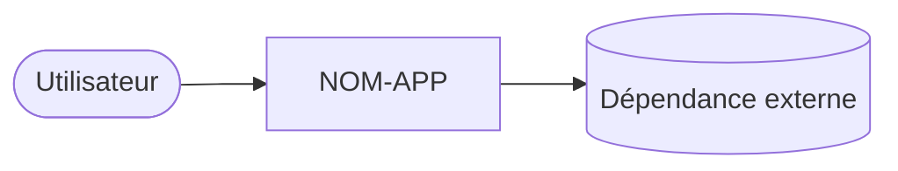
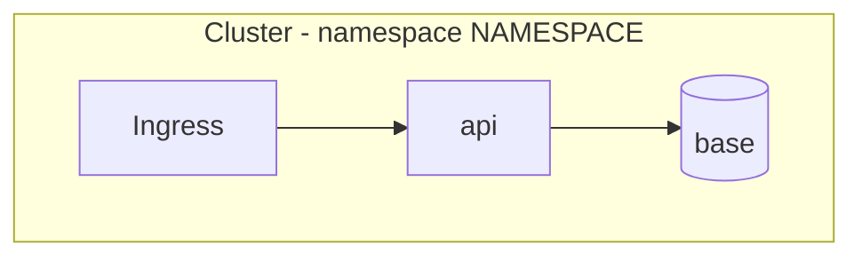

# Architecture

> Plan arc42 allégé.

## 1. Objectif et contraintes
TODO(ops-doc): à quoi sert l'app, ordre de grandeur du trafic, contraintes (budget, équipe, RGPD, hébergement).

## 2. Contexte (C4, niveau 1)

## 3. Conteneurs (C4, niveau 2)

## 4. Flux réseau

| Source | Destination | Port | Pourquoi |
|---|---|---|---|
| | | | |

## 5. Données
- **Où** :
- **Quoi** (données personnelles ? rétention ?) :
- **Sauvegardes** (outil, fréquence, rétention, emplacement) :
- **Logs** (où, rétention) :

## 6. Déploiement
TODO(ops-doc): chaîne CI → registry → GitOps → cluster, stratégie de tags, environnements.

## 7. Décisions
Voir `adr/`.

## 8. Risques connus et dette

| Risque | Impact | Mitigation |
|---|---|---|
| | | |
