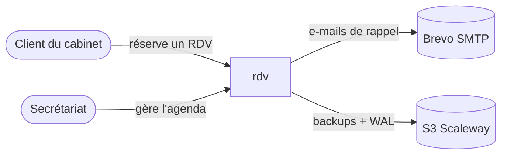
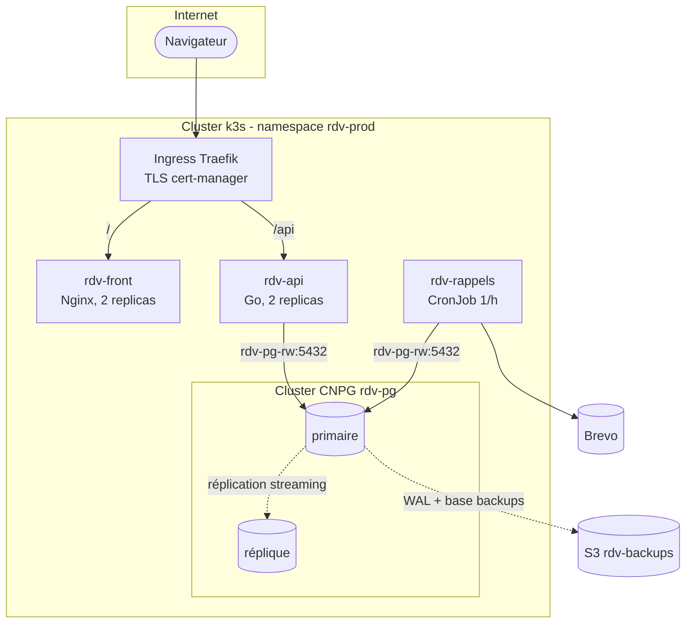
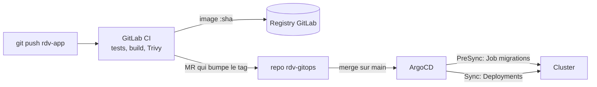

# Architecture

> Plan **arc42 allégé** : on garde les sections utiles à une petite app. L'arc42 complet en compte 12.

## 1. Objectif et contraintes
- Permettre la prise de RDV en ligne 24h/24 ; trafic faible (≈ 200 réservations/jour, pics à 20 req/s).
- **Contraintes** : budget minimal (un cluster k3s de 3 nœuds), une seule personne pour le dev et l'ops, données personnelles (RGPD) hébergées en UE.

## 2. Contexte (C4, niveau 1)

## 3. Conteneurs (C4, niveau 2)

## 4. Flux réseau (= ce qu'autorisent les NetworkPolicies)

| Source | Destination | Port | Pourquoi |
|---|---|---|---|
| Traefik (`kube-system`) | `rdv-front`, `rdv-api` | 8080 | Trafic entrant |
| `rdv-api`, `rdv-rappels` | `rdv-pg` | 5432 | Accès base |
| Opérateur CNPG (`cnpg-system`) | `rdv-pg` | 8000, 5432 | Gestion du cluster |
| `rdv-pg` | S3 Scaleway | 443 | Backups |
| Prometheus (`monitoring`) | tous | 9187, 8080 | Scraping des métriques |
| *tout le reste* | | | **refusé** (default deny) |

## 5. Données
- **Où** : PostgreSQL `rdv-pg`, base `app`. PVC `local-path` de 10 Gi pour les données et 5 Gi pour le WAL, sur chaque instance.
- **Quoi** : clients (nom, e-mail, téléphone), RDV, créneaux. **Données personnelles**, rétention de 3 ans puis purge (CronJob `rdv-purge`).
- **Sauvegardes** : plugin Barman Cloud, WAL archivé en continu, base backup quotidien à 3h, rétention 30 jours, bucket `rdv-backups` (Scaleway, hors du cluster).
- **Logs** : Loki, rétention 30 jours. Les e-mails et téléphones sont masqués dans les logs applicatifs.

## 6. Déploiement (GitOps)

- Les images sont taguées par **SHA de commit**, jamais `latest`.
- Staging se synchronise automatiquement sur `main`. La prod se synchronise sur le tag Git `prod-*`.
- Les migrations tournent dans un Job en hook `PreSync` ([ADR 0002](adr/0002-migrations-presync.md)).

## 7. Décisions
Voir `adr/`. Les décisions structurantes :
- [0001 : CNPG plutôt qu'une base managée](adr/0001-cnpg.md)
- [0002 : migrations en hook PreSync](adr/0002-migrations-presync.md)

## 8. Risques connus et dette
| Risque | Impact | Mitigation |
|---|---|---|
| Une seule personne connaît l'app | Pas de reprise si je suis indisponible | Cette doc + un suppléant à former |
| Stockage `local-path` (lié au nœud) | Si un nœud meurt, son instance PG doit être reconstruite | 2 instances CNPG sur 2 nœuds différents (anti-affinité) |
| Un seul fournisseur S3 | Si on perd le bucket, on perd les backups | *À faire* : réplication vers un 2e fournisseur |
